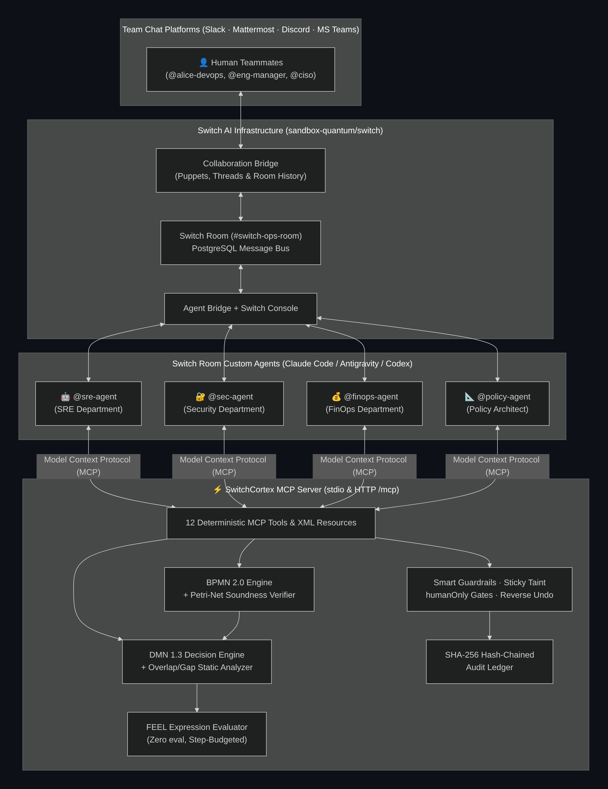

# ⚡ SwitchCortex — Deterministic BPMN 2.0, DMN 1.3 & FEEL Governance Cortex for Switch AI Rooms

> **Built for the WeMakeDevs × DevTools Academy × Switch AI ("Flip the Switch") Hackathon**
>
> *"AI agents propose in the Switch Room. Formal models decide."*

---

## 🎯 The Problem: Why Multi-Agent Chat Rooms Break in Production

[**Switch AI**](https://github.com/sandbox-quantum/switch) (`docs.switchagents.ai`) transforms isolated terminal coding agents (*Claude Code, Antigravity, Codex, Cursor, OpenCode*) into collaborative teammates inside shared messaging channels (*Slack, Mattermost, Discord, Microsoft Teams*).

However, when you place **multiple specialized department agents** (`@sre-agent`, `@sec-agent`, `@finops-agent`, `@policy-agent`) and humans inside the same Switch Room to run real operational workflows, **prompt-only coordination fails**:
1. **Unverified Handoffs & Race Conditions:** Agents act out of turn, skip mandatory Security or FinOps reviews, or deadlock waiting for each other.
2. **Hallucinated Authority:** An agent decides on its own that a `+$3,200/mo` production GPU burst is "probably fine," or attempts to self-approve an executive gate.
3. **Unsafe Policy Edits in Chat:** When a manager asks an agent in chat to add a fast-track rule or shortcut a workflow, the LLM introduces **conflicting decision rules (overlaps)**, **uncovered edge cases (gaps)**, or **Petri-net workflow deadlocks**.

---

## 💡 The Solution: SwitchCortex

**SwitchCortex** is a zero-dependency, standards-based **Model Context Protocol (MCP) Governance Cortex** for Switch AI Rooms. Instead of relying on LLM vibes to coordinate multi-department handoffs, SwitchCortex governs the Switch Room using three formal OMG standards:

1. **BPMN 2.0 (`src/bpmn/`) — The Switch Room Conductor**
   - Controls who speaks and acts when via Petri-net token semantics (`startEvent`, `serviceTask`, `businessRuleTask`, `userTask`, `exclusiveGateway`, `parallelGateway`).
   - Enforces **parallel multi-department forks and joins** (e.g., `@sec-agent` and `@finops-agent` must *both* complete their audits before the `parallelGateway` join unlocks the human executive gate).
   - Includes a **Formal Petri-Net Soundness Verifier** (`verifyBpmnSoundness`) that statically detects deadlocks, lack of synchronization at parallel joins, unreachable nodes, and stranded tokens.
2. **DMN 1.3 (`src/dmn/`) — Deterministic Auto vs. Manual Gatekeeper**
   - Separates **AI Proposal** from **Policy Decision**: Agents inspect logs/diffs and propose structured facts (`{env, cost_delta, touches_pii, public_exposure, confidence}`), while a verified DMN 1.3 Decision Table deterministically decides whether to:
     - **`auto_approve`** (Green Lane fast-track — zero human interruption),
     - **`require_dept_signoff`** / **`require_exec_and_dept_signoff`** (forks parallel Security + FinOps audits + Human Executive approval), or
     - **`reject`** (hard compliance block).
   - Includes a **Formal Static Analyzer** (`analyzeDecisionTable`) that mathematically checks candidate decision tables across finite-domain equivalence classes to catch **conflicting rule overlaps** and **coverage gaps** with concrete counterexamples.
3. **FEEL (`src/feel/`) — Safe, Budgeted Expression Language**
   - Evaluates all DMN cells and BPMN gateway conditions using a clean-room OMG FEEL parser and evaluator (3-valued logic, intervals `[101..10000]`, unary tests, static `freeVariables` extraction, step budgets, and zero `eval()`).

---

## 🏗️ Architecture & Switch AI Integration



---

## 🚀 Quickstart (< 60 Seconds)

SwitchCortex requires **Node.js >= 20** and has **zero external runtime dependencies** (pre-compiled ESM in `dist/` is included for instant execution).

```bash
# 1. Run the 4-Scenario Switch AI Room simulation in your terminal
npm run demo

# 2. Run the Formal Static Verifier (DMN 1.3 + BPMN 2.0 + Counterexample Proofs)
npm run verify

# 3. Run the automated test suite (23 unit & integration tests across FEEL, DMN, BPMN, Governance & MCP)
npm test

# 4. Launch the Streamable HTTP MCP Server + Interactive Web Governance Studio
npm run serve
# -> Open http://localhost:4100 in your browser
# -> Connect MCP clients to http://localhost:4100/mcp
```

---

## 🎬 The 4 Live Hackathon Demo Scenarios

Running `npm run demo` (or clicking **"▶ Run All 4 Hackathon Scenarios"** in the Web Studio at `http://localhost:4100`) executes four real operational scenarios through the SwitchCortex engine:

### Scenario 1 — Green Lane: 100% Automatic Approval
* **Trigger:** `@alice-devops` asks `@sre-agent` in `#switch-ops-room` to scale `staging-search-indexer` from 2 to 4 pods.
* **Execution:** `@sre-agent` triages the request (`env: "staging"`, `cost_delta: 45`, `touches_pii: false`, `confidence: 0.96`).
* **DMN 1.3 Verdict:** Rule `R10_GREEN_LANE_AUTO_APPROVE` matches → `verdict = "auto_approve"`.
* **BPMN 2.0 Routing:** The `exclusiveGateway` routes directly to `task_sre_execute`, deploying `deploy-stg-8821` automatically without interrupting human managers.

### Scenario 2 — Multi-Department Parallel Review + Human-Only Gate
* **Trigger:** Urgent production checkout latency spike requiring hotfix `v2.14.1` and a 4x A10G GPU burst (`env: "prod"`, `cost_delta: 3200`, `public_exposure: true`).
* **DMN 1.3 Verdict:** Rule `R6_PROD_STANDARD_MULTI_DEPT` matches → `verdict = "require_dept_signoff"`, `required_approver = "@eng-manager"`.
* **Parallel BPMN Fork & Cross-Department ACL:** `gw_dept_fork` dispatches concurrent tasks to **Security** (`@sec-agent`) and **FinOps** (`@finops-agent`). When `@sre-agent` attempts to forge `@sec-agent`'s sign-off, SwitchCortex blocks it with **`ERR_DEPARTMENT_ACL_DENIED`**.
* **Blocked Agent Self-Approval (`ERR_HUMAN_ONLY_GATE`):** After `@sec-agent` and `@finops-agent` both approve and synchronize at `gw_dept_join`, the `userTask` (`task_human_approval`) opens. `@sre-agent` attempts to approve the human gate to save time and is **deterministically blocked (`ERR_HUMAN_ONLY_GATE`)** and logged in the SHA-256 audit ledger.
* **Human Sign-Off & Rollout:** Human `@eng-manager` approves in the Switch Room, unlocking `task_sre_execute` (`deploy-prod-9904`).

### Scenario 3 — Hard PII Guardrail Block, Sticky Taint & Compensating Undo Rollback
* **Part A (Hard Compliance Invariant):** An external bot requests making `s3://prod-customer-pii-export` public (`touches_pii: true`, `public_exposure: true`, `tainted: true`). Sticky taint caps effective confidence to `0.65`, and DMN Rule `R1_BLOCK_PUBLIC_PII` immediately halts the workflow (`completed_rejected`).
* **Part B (Reverse-Topological Supervision Rollback):** During a production payment ledger canary migration (`WF-104`), `@ciso` triggers `cortex_supervise_control({ action: "undo_workflow" })`. SwitchCortex automatically executes compensating actions in **reverse topological order**:
  `release_reserved_cloud_budget` → `revoke_temporary_security_clearance` → `revert_sre_triage_workspace`.

### Scenario 4 — Live Design-Time Formal Verification in Chat ("The Wow Moment")
* **Trigger:** A manager asks `@policy-agent` in chat to add a fast-track DMN rule (*"auto-approve whenever confidence >= 0.90"*) and shortcut the BPMN workflow (*"bypass Security and go straight to FinOps before the join gateway"*).
* **Mathematical Rejection:**
  1. **DMN Static Verifier (`ERR_DMN_FORMAL_VERIFICATION_FAILED`):** Rejects the table and outputs the exact counterexample `{"env":"dev","cost_delta":0,"touches_pii":true,"public_exposure":true,"confidence":0.9}` where the new rule (`auto_approve`) collides with `R1_BLOCK_PUBLIC_PII` (`reject`).
  2. **BPMN Petri-Net Soundness Verifier (`ERR_BPMN_SOUNDNESS_FAILED`):** Rejects the workflow and proves that bypassing `@sec-agent` leaves `gw_dept_fork` and `task_sec_audit` unreachable and causes an **`ERR_LACK_OF_SYNCHRONIZATION` deadlock** at `gw_dept_join`.

---

## 🛠️ Model Context Protocol (MCP) Tools Reference

SwitchCortex exposes **12 MCP tools** over both `stdio` (`npx switch-cortex mcp`) and Streamable HTTP (`POST http://localhost:4100/mcp`):

| MCP Tool Name | Used By | Purpose |
|---|---|---|
| `cortex_list_blueprints` | Any Agent / Operator | List registered BPMN 2.0 & DMN 1.3 blueprints, SHA-256 digests, and verification status |
| `cortex_start_workflow` | `@sre-agent` / Humans | Start a new multi-department BPMN 2.0 workflow instance in a Switch Room |
| `cortex_get_instance` | Any Agent / Operator | Inspect active BPMN tokens, variables, DMN traces, and room transcript |
| `cortex_submit_agent_task` | `@sre-agent`, `@sec-agent`, `@finops-agent` | Submit structured task outputs & justification; advances BPMN tokens and evaluates DMN gates |
| `cortex_evaluate_dmn` | Any Agent | Dry-run evaluate a DMN 1.3 table with full cell-by-cell FEEL trace |
| `cortex_verify_dmn` | `@policy-agent` | Run formal static verification on a DMN 1.3 table (overlaps, gaps, shadowed rules) |
| `cortex_verify_bpmn` | `@policy-agent` | Run Petri-net soundness verification on a BPMN 2.0 process (deadlocks, sync errors) |
| `cortex_register_policy` | `@policy-agent` | Register a DMN or BPMN blueprint **only if** formal verification passes |
| `cortex_list_inbox` | All Agents & Humans | List pending department tasks and `humanOnly` approval gates |
| `cortex_decide_human_gate` | Human Executives Only | Approve/reject a `userTask` (`ERR_HUMAN_ONLY_GATE` if called by an AI agent) |
| `cortex_supervise_control` | Human Supervisors | Engage/release kill-switch, pause/resume agent role, or run `undo_workflow` rollback |
| `cortex_verify_audit_chain` | Any Agent / Auditor | Verify the SHA-256 hash chain and render a Markdown audit table for the Switch Room |

---

## 🔌 Connecting to Switch AI (`sandbox-quantum/switch`)

All configuration files for **Switch Console** and coding harnesses are located in [`switch-workspace/`](./switch-workspace/):

```bash
# Register both SwitchCortex MCP and official Switch Docs MCP with Claude Code / Codex:
bash ./scripts/setup-switch-mcp.sh
```

Or manually add the MCP servers:
```bash
# Official Switch AI Documentation MCP
claude mcp add switch-docs --transport http https://docs.switchagents.ai/mcp

# SwitchCortex Governance MCP (stdio)
claude mcp add switch-cortex -- node "$(pwd)/dist/src/cli/index.js" mcp
```

See [`docs/SWITCH_SETUP.md`](./docs/SWITCH_SETUP.md) for the complete Switch Console multi-agent setup guide, [`docs/ARCHITECTURE.md`](./docs/ARCHITECTURE.md) for the formal verification internals, and [`docs/DEMO_SCRIPT.md`](./docs/DEMO_SCRIPT.md) for the 3-minute demo video script.

---

## 📂 Repository Structure

```text
switch-cortex/
├── blueprints/                  # Exported standard OMG BPMN 2.0 XML, DMN 1.3 XML & JSON blueprints
├── docs/                        # Architecture deep-dive, Switch AI setup guide & 3-min demo script
├── scripts/                     # One-command MCP registration script for Switch agents
├── src/
│   ├── feel/engine.ts           # Clean-room FEEL parser, evaluator & domain boundary extractor
│   ├── dmn/engine.ts            # DMN 1.3 decision table engine, XML exporter & overlap/gap verifier
│   ├── bpmn/engine.ts           # BPMN 2.0 token engine, XML exporter & Petri-net soundness verifier
│   ├── governance/runtime.ts    # Multi-department ACL, sticky taint, humanOnly gates & undo rollback
│   ├── storage/ledger.ts        # Append-only SHA-256 cryptographic hash-chained audit ledger
│   ├── blueprints/defaults.ts   # Verified production DMN/BPMN blueprints + flawed test proposals
│   ├── mcp/server.ts            # MCP JSON-RPC 2.0 server (stdio & HTTP transports, 12 tools, 3 resources)
│   ├── sim/scenarios.ts         # 4 deterministic end-to-end Switch Room demo scenarios
│   ├── server/http.ts           # Streamable HTTP MCP server + Interactive Web Governance Studio
│   └── cli/index.ts             # CLI entrypoint (demo, verify, mcp, serve, export-blueprints)
├── switch-workspace/            # Per-agent CLAUDE.md briefs, .mcp.json, and illustrative YAML reference configs
└── test/                        # 23 automated unit & integration tests (node:test)
```

## 📄 License

MIT License — see [LICENSE](./LICENSE).

---

## ✅ Honest Scope Note (Hackathon Judges)

- **Switch is the room; SwitchCortex is the governance layer inside it.** The agents (`@sre-agent`, `@sec-agent`, `@finops-agent`, `@policy-agent`) are Claude Code agents onboarded in Switch Console (see [`docs/SWITCH_SETUP.md`](./docs/SWITCH_SETUP.md)) that call SwitchCortex over MCP (`switch-workspace/.mcp.json`).
- `npm run demo` is a **deterministic simulation** of those four room scenarios so anyone can clone and reproduce them without a Switch server. It does not require credentials.
- `switch-workspace/*.yaml` files are illustrative reference configs, not a Switch-native schema.
- Optional live mode (`npm run live`) uses `GEMINI_API_KEY` / `SLACK_WEBHOOK_URL` from a local `.env` (see `.env.example`).
